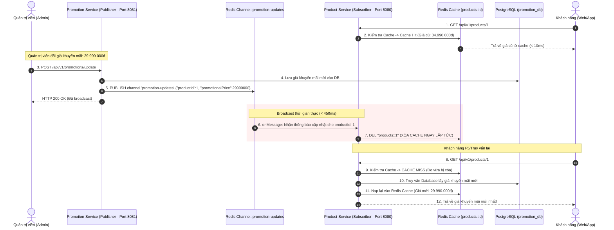

# [Bài tập 4] Cập nhật giá khuyến mãi thời gian thực với Redis Pub/Sub

Dự án triển khai cơ chế đồng bộ và làm mới dữ liệu giá khuyến mãi thời gian thực (Real-time Cache Invalidation) giữa các Microservices bằng **Redis Pub/Sub** trên nền tảng **Spring Boot**, **PostgreSQL** và **Redis**.

---

## 1. Mục tiêu & Bối cảnh bài toán

* **Bối cảnh**: Trong các hệ thống thương mại điện tử, giá sản phẩm được lưu đệm trong **Redis Cache** theo mô hình **Cache-Aside** để tối ưu tốc độ đọc (phản hồi $<10\text{ms}$). Tuy nhiên, khi quản trị viên thay đổi giá hoặc áp dụng chương trình khuyến mãi mới, nếu không có cơ chế làm mới tức thì, người dùng vẫn sẽ nhìn thấy giá cũ trong cache cho đến khi TTL hết hạn.
* **Giải pháp với Redis Pub/Sub**:
  * **Promotion-Service (Publisher - Port 8081)**: Khi quản trị viên cập nhật giá khuyến mãi, service lưu dữ liệu và phát (publish) một thông điệp chứa `productId`, `promotionalPrice` vào Redis Channel `promotion-updates`.
  * **Product-Service (Subscriber - Port 8080)**: Thường trực lắng nghe channel `promotion-updates`. Ngay khi nhận được thông điệp, service lập tức **xóa cache Redis** của sản phẩm đó (`products::{id}`).
  * **Kết quả**: Lần truy vấn tiếp theo của người dùng (Web, App) sẽ buộc phải lấy giá khuyến mãi mới nhất từ Database và nạp lại vào Redis Cache. Toàn bộ chu trình hoàn tất trong **chưa đầy 1 giây** ($< 450\text{ms}$).

---

## 2. Kiến trúc & Sơ đồ luồng dữ liệu (Redis Pub/Sub)



---

## 3. Cấu trúc thư mục dự án

```text
MD_04_Buoi12_Gio1/
│── docker-compose.yml          # Dịch vụ PostgreSQL (promotion_db) & Redis (port 6379)
│── README.md                   # Tài liệu hướng dẫn & Báo cáo kết quả kiểm thử
├── promotion-service/          # Publisher Service (Port 8081)
│   ├── build.gradle
│   └── src/main/java/com/example/promotionservice/
│       ├── config/RedisPublisherConfig.java       # Cấu hình RedisTemplate Publisher & ChannelTopic
│       ├── controller/PromotionController.java    # API cập nhật khuyến mãi
│       ├── dto/PromotionUpdateMessage.java        # Message DTO
│       └── publisher/PromotionPublisher.java      # Gửi tin nhắn vào channel promotion-updates
└── product-service/            # Subscriber Service (Port 8080)
    ├── build.gradle
    └── src/
        ├── main/java/com/example/productservice/
        │   ├── config/
        │   │   ├── RedisSubscriberConfig.java     # Cấu hình RedisMessageListenerContainer
        │   │   └── DataInitializer.java          # Khởi tạo sẵn sản phẩm mẫu
        │   ├── controller/ProductController.java  # API xem sản phẩm & trạng thái cache
        │   ├── entity/Product.java                # Entity Product trong DB
        │   ├── repository/ProductRepository.java
        │   ├── service/ProductService.java        # Cache-Aside pattern (Redis)
        │   └── subscriber/PromotionMessageSubscriber.java # Lắng nghe Pub/Sub & XÓA CACHE
        └── test/java/com/example/productservice/
            └── RedisPubSubRealtimeTest.java       # Test tự động luồng Pub/Sub & xóa cache (< 1s)
```

---

## 4. Hướng dẫn khởi chạy

### Bước 1: Khởi động Redis & PostgreSQL với Docker
Tại thư mục gốc dự án:
```bash
docker compose up -d
```
* **Redis**: `localhost:6379`
* **PostgreSQL**: `localhost:5432` (Database: `promotion_db`, User: `postgres`, Password: `123456`)

### Bước 2: Chạy 2 Microservices
Mở 2 cửa sổ terminal riêng biệt:

* **Terminal 1: Product-Service (Subscriber - Port 8080)**
  ```bash
  cd product-service
  ./gradlew bootRun
  ```

* **Terminal 2: Promotion-Service (Publisher - Port 8081)**
  ```bash
  cd promotion-service
  ./gradlew bootRun
  ```

---

## 5. Kịch bản kiểm thử API & Thời gian thực (< 1s)

### 5.1. Xem sản phẩm ban đầu (Lần 1 - Cache Miss)
```bash
curl -X GET http://localhost:8080/api/v1/products/1
```
* **Console**: `[CACHE MISS] Đang truy vấn sản phẩm ID=1 từ PostgreSQL Database...`
* **Kết quả**:
  ```json
  {
    "id": 1,
    "name": "iPhone 16 Pro Max 256GB Titan Tự Nhiên",
    "originalPrice": 34990000.00,
    "promotionalPrice": null,
    "currentPrice": 34990000.00,
    "onPromotion": false
  }
  ```

### 5.2. Xem lại sản phẩm (Lần 2 - Cache Hit)
```bash
curl -X GET http://localhost:8080/api/v1/products/1
```
* **Thời gian phản hồi**: `< 5ms`.
* **Console**: `[CACHE HIT] Lấy dữ liệu sản phẩm ID=1 trực tiếp từ Redis Cache (Không chạm DB)`.

### 5.3. Quản trị viên cập nhật giá khuyến mãi (Promotion-Service)
Gửi yêu cầu cập nhật giá mới xuống `promotion-service`:
```bash
curl -X POST http://localhost:8081/api/v1/promotions/update \
  -H "Content-Type: application/json" \
  -d '{
    "productId": 1,
    "promotionalPrice": 29990000,
    "promotionName": "Siêu Sale Giữa Tháng"
  }'
```

* **Console `promotion-service`**:
  ```text
  📢 [PROMOTION-SERVICE] Gửi thành công tới channel 'promotion-updates' cho ProductId: 1
  ```

* **Console `product-service` (Nhận ngay trong ~400ms)**:
  ```text
  ==================================================================
  🔔 [PRODUCT-SERVICE] [Redis Pub/Sub Subscriber] Nhận được message từ channel 'promotion-updates'
  🔔 [PRODUCT-SERVICE] Chi tiết: Cập nhật khuyến mãi cho Sản phẩm ID=1, Giá mới=29990000
  💾 [PRODUCT-SERVICE] Đã cập nhật giá khuyến mãi vào Database cho sản phẩm #1
  🧹 [PRODUCT-SERVICE] ==> ĐÃ XÓA CACHE Redis key 'products::1' (Kết quả: true). Lần truy vấn tiếp theo bắt buộc nạp lại giá mới từ Database!
  ==================================================================
  ```

### 5.4. Khách hàng truy vấn lại giá sản phẩm (Lần 3)
```bash
curl -X GET http://localhost:8080/api/v1/products/1
```
* **Kết quả**: Giá khuyến mãi mới `29.990.000đ` được cập nhật ngay lập tức:
  ```json
  {
    "id": 1,
    "name": "iPhone 16 Pro Max 256GB Titan Tự Nhiên",
    "originalPrice": 34990000.00,
    "promotionalPrice": 29990000.00,
    "currentPrice": 29990000.00,
    "onPromotion": true
  }
  ```

---

## 6. Chạy Integration Test tự động

```bash
cd product-service
./gradlew test
```

### Kết quả chạy kiểm thử thực tế:
```text
RedisPubSubRealtimeTest STANDARD_OUT
    ===> [BƯỚC 1] Đã lưu vào Redis Cache: true
    ===> [BƯỚC 3] Đã phát thông điệp khuyến mãi lên Redis Channel: promotion-updates
    ===> [BƯỚC 4] Thời gian truyền tin và xóa cache: 410 ms (< 1000 ms)
    ===> [BƯỚC 4] Cache key trong Redis sau khi nhận Pub/Sub message: false (ĐÃ BỊ XÓA)
    ===> [BƯỚC 5] Giá mới nhất sau khi query lại: 26990000.00 VNĐ

RedisPubSubRealtimeTest > Kiểm thử cập nhật giá khuyến mãi thời gian thực với Redis Pub/Sub và xóa cache tự động (< 1s) PASSED
BUILD SUCCESSFUL in 29s
```
